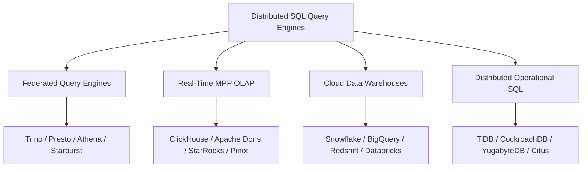

  

# ⚡ Awesome-Distributed-SQL-Query-Engines

  
  
  
  
  

## 🚀 The Ultimate Distributed SQL Query Engines Directory

> 🌐 **Curated List of Production SaaS Platforms & Open-Source Projects** for **Distributed SQL Query Engines**, **Federated Analytics**, **Open Data Lakehouses (Iceberg / Delta / Hudi)**, and **Massively Parallel Processing (MPP)**.

**Last updated: October 2026** 📅

Distributed SQL query engines allow organizations to query massive multi-petabyte datasets across data lakes, object storage (Amazon S3, Azure Data Lake Storage, Google Cloud Storage), data warehouses, and relational databases without complex ETL pipelines. Whether you need federated query execution reading in-place, vectorized single-node analytical processing, or horizontally scalable cloud MPP warehouses, this guide covers the entire ecosystem. 📊

---

## 📑 Table of Contents

- [📈 Sector Overview & Market Dynamics](#-sector-overview--market-dynamics)
- [☁️ SaaS & Hosted Platforms](#️-saas--hosted-platforms)
- [🔓 Open-Source GitHub Projects](#-open-source-github-projects)
- [🧭 Architectural Taxonomy & Engine Archetypes](#-architectural-taxonomy--engine-archetypes)
- [🤝 How to Contribute](#-how-to-contribute)
- [💖 Support](#-support)
- [📊 Star History](#-star-history)
- [⚠️ Disclaimer](#️-disclaimer)

---

## 📈 Sector Overview & Market Dynamics

The global **data lake query engine and distributed SQL analytics market** is estimated at **$8.7 billion** and is projected to surge to **$38.4 billion by 2034**, expanding at a compound annual growth rate (CAGR) of **~17.9%**. 

The sector is **moderately concentrated** at the top tier: hyperscale cloud providers (**Google BigQuery**, **AWS Athena & Redshift**) alongside enterprise lakehouse pioneers (**Databricks SQL**, **Snowflake**) command over 65% of commercial spending. However, the ecosystem remains resistant to a single "winner-take-all" outcome due to a thriving, fast-moving open-source community (**Trino**, **Presto**, **DuckDB**, **ClickHouse**, **Apache Doris**, **StarRocks**) and specialized independent cloud vendors (**Starburst**, **Dremio**). Organizations increasingly favor composable lakehouses and open table formats (Apache Iceberg) over proprietary walled gardens, preserving vigorous architectural competition across both cloud and on-premise deployments. 🌐

---

## ☁️ SaaS & Hosted Platforms

> 📌 *Sorted by **Company Scale** (Valuation / Revenue, descending). All pricing reflects current publicly listed starting-tier commercial rates as of October 2026.*

| Platform | Description | Pricing (Starting Tier) | Free Tier / Free Trial Limits | Company Scale | Best For |
|---|---|---|---|---|---|
| **[Google BigQuery](https://cloud.google.com/bigquery)** 🔍 | Serverless enterprise data warehouse with on-demand and autoscaling capacity editions | On-demand: **$6.25 per TiB** scanned; Standard edition from **$0.04/slot-hour** with autoscaling | **Forever free**: 1 TiB queries scanned/mo + 10 GB active storage/mo per project (lifetime, no credit card req'd) | Alphabet — **~$4.1 T market cap**; Google Cloud **$24.8 B quarterly rev** (Q2 2026) | Serverless enterprise analytics with a perpetual free tier |
| **[AWS Athena](https://aws.amazon.com/athena/)** ⚡ | Serverless interactive query engine based on Presto/Trino & Apache Spark on S3 | **$5.00 per TB** scanned (10 MB minimum per query); Spark compute at **$0.35/DPU-hour** | **No perpetual free tier**; DDL queries and failed executions are free; new AWS signups receive general $300 tier credit pool | Amazon — **~$2.8 T market cap**; AWS **$42.2 B quarterly rev** (Q2 2026) | Zero-maintenance ad-hoc SQL querying over S3 data lakes |
| **[Amazon Redshift](https://aws.amazon.com/redshift/)** 🗄️ | Cloud MPP data warehouse with provisioned clusters and serverless compute | Provisioned from **$0.543/hr** (dc2.large); Serverless from **$0.375/RPU-hour** (~$1.50/hr at base 4 RPU) | **Trial only**: 2-month free trial with **$300 in credits** for provisioned clusters; Redshift Serverless has no perpetual free tier | Amazon — **~$2.8 T market cap**; AWS **$42.2 B quarterly rev** (Q2 2026) | High-concurrency BI and AWS-native warehouse workloads |
| **[Databricks SQL](https://www.databricks.com/product/databricks-sql)** 🧱 | Serverless and classic SQL data warehouse built natively on the Delta Lake lakehouse | SQL Pro: **$0.22/DBU** (+ VM instance); Classic: **$0.55/DBU**; Serverless SQL: **$0.70/DBU** (compute included) | **Trial only**: 14-day free trial on AWS/Azure/GCP; **Community Edition** is free forever but limited to 1 node & non-production use | Databricks — **$190 B valuation** (Aug 2026); **$7 B+ revenue run-rate** | Unified analytics across Delta Lake, streaming, and machine learning |
| **[Snowflake](https://www.snowflake.com/)** ❄️ | Multi-cloud consumption-based data cloud warehouse and analytics engine | Standard: **$2.00/credit**; Enterprise: **$3.00/credit**; Business Critical: **$4.00/credit** (AWS US East pricing) | **Trial only**: 30-day free trial with **$400 in usage credits** + Enterprise features; no perpetual free tier | Snowflake — **~$105–118 B market cap**; **$5.4 B TTM revenue** | Zero-ops cloud data warehousing with cross-cloud data sharing |
| **[Starburst Galaxy](https://www.starburst.io/platform/starburst-galaxy/)** 🌌 | Fully managed Trino SaaS engine for multi-cloud federated data lake querying | Standard/Pro: **$0.50/credit**; Enterprise: **$0.75/credit**; Mission-Critical: **$1.00/credit** | **Forever free**: 3 clusters with standard execution mode; **30-day trial** with **$500 in compute credits** for Enterprise | Starburst Data — **$3.35 B valuation** (Series D); **$100 M+ ARR** | Managed Trino federation without maintaining distributed coordinators |
| **[Teradata Vantage](https://www.teradata.com/products/vantagecloud)** 🏢 | Enterprise-grade MPP analytical platform and lakehouse engine | VantageCloud Lake Standard from **$4.80/hr** (~$1.50/TU); Lake+ from **$7.20/hr**; cloud storage ~$23/TB/mo | **Trial only**: ClearScape Analytics Experience — free sandbox with 250+ guided demos, no credit card req'd; no production free tier | Teradata — **~$2.8 B market cap**; **$1.69 B TTM revenue** | Legacy enterprise migrations and petabyte-scale financial analytics |
| **[Dremio Cloud](https://www.dremio.com/)** 🌊 | Managed Apache Arrow-powered lakehouse engine with Autonomous Data Reflections | Pay-as-you-go: **$0.20/DCU**; XS engine ~$6.40/hr, S engine ~$12.80/hr, M engine ~$25.60/hr | **Forever free**: Standard tier — ≤10 users, ≤200 tables, ≤1,000 views, engine capped at Small; **Enterprise trial**: $400 credits / 30 days | Dremio — acquired by **SAP** (May 2026); last valuation **$2 B** | Sub-second SQL queries directly over Apache Iceberg lakes |

---

## 🔓 Open-Source GitHub Projects

> 📌 *Sorted by **GitHub_Stars** (descending). Badges reflect real-time stargazers count (`style=social`, `color=white`) and link directly to each project's stargazers page.*

- **[ClickHouse](https://github.com/ClickHouse/ClickHouse)**  ⚡  
  **Column-oriented DBMS for real-time analytical reporting** (Apache-2.0). Widely recognized as one of the fastest open-source single-node and distributed analytics engines in hardware benchmark comparisons, delivering sub-second queries over billions of rows. **Best for**: real-time analytics, telemetry, log monitoring, and high-concurrency dashboards.

- **[Apache Spark](https://github.com/apache/spark)**  🔥  
  **Unified analytics engine for large-scale distributed data processing** (Apache-2.0). Provides distributed SQL via Spark SQL, Catalyst cost-based optimizer pushdowns, DataFrame/Dataset APIs, and structured streaming across thousands of cluster nodes. **Best for**: massive-scale batch data pipelines, ETL transformations, and distributed machine learning at petabyte scale.

- **[DuckDB](https://github.com/duckdb/duckdb)**  🦆  
  **In-process SQL OLAP database management system** (MIT). Benchmarks demonstrate native vectorized columnar execution achieves exceptional runtimes on Parquet, CSV, and Iceberg formats with zero external dependencies. **Best for**: embedded analytical engines, single-node data wrangling, serverless lambdas, and fast Python/R analytics.

- **[TiDB](https://github.com/pingcap/tidb)**  🗄️  
  **Distributed Hybrid Transactional and Analytical Processing (HTAP) database** (Apache-2.0). MySQL compatible, horizontal elasticity, strong Raft consensus, and real-time analytical queries using the decoupled TiFlash columnar engine. **Best for**: modern HTAP workloads demanding zero-ETL transaction processing combined with distributed analytical SQL.

- **[CockroachDB](https://github.com/cockroachdb/cockroach)**  🪳  
  **Cloud-native distributed SQL database built on transactional key-value architecture** (BSL / Open Source core). Delivers PostgreSQL dialect compatibility, multi-region geographic distribution, and survivability against data center failures. **Best for**: globally distributed operational applications requiring strict serializable ACID consistency.

- **[Apache Arrow](https://github.com/apache/arrow)**  🏹  
  **Standardized multi-language platform for in-memory columnar data** (Apache-2.0). The definitive data exchange and execution specification powering modern vectorized engines including DuckDB, Velox, and DataFusion with zero serialization overhead. **Best for**: zero-copy cross-engine data interchange and high-performance columnar compute.

- **[Presto (PrestoDB)](https://github.com/prestodb/presto)**  🦅  
  **Distributed SQL query engine for big data** (Apache-2.0) — **the original Presto architecture** born at Meta and governed by the Presto Foundation. Modern deployments pair Presto with native C++ Velox acceleration for high-throughput SQL. **Best for**: interactive ad-hoc SQL analytics at hyperscale across open data lakes.

- **[Apache Doris](https://github.com/apache/doris)**  🐬  
  **Real-time analytical database** (Apache-2.0) — **the MySQL-compatible OLAP powerhouse**. Offers sub-second query performance over huge datasets with lakehouse federation, inverted indexes, and real-time stream ingestion. **Best for**: interactive analytics, user-facing BI dashboards, and high-throughput real-time reporting.

- **[Trino](https://github.com/trinodb/trino)**  🗡️  
  **Fast distributed SQL query engine for big data** (Apache-2.0) — **the federated querying standard**. Connects to 40+ heterogeneous sources (Apache Iceberg, Delta Lake, Hive, PostgreSQL, MySQL, Kafka, Elasticsearch) without moving data. **Best for**: querying heterogeneous data architectures without ETL and querying across multi-cloud lakes.

- **[Citus](https://github.com/citusdata/citus)**  🐘  
  **Distributed PostgreSQL extension for horizontal scale** (AGPL-3.0). Transforms PostgreSQL into a distributed database, transparently sharding tables and parallelizing complex SQL queries across worker clusters. **Best for**: scaling multi-tenant SaaS databases and real-time operational analytics on Postgres.

- **[StarRocks](https://github.com/StarRocks/starrocks)**  🌟  
  **Sub-second MPP OLAP database for modern lakehouse analytics** (Apache-2.0). Engineered with vectorized C++ execution, Cost-Based Optimizer (CBO), and intelligent real-time materialized views directly against open lake formats. **Best for**: low-latency lakehouse queries, real-time analytics, and high-concurrency BI dashboards.

- **[YugabyteDB](https://github.com/yugabyte/yugabyte-db)**  🚀  
  **Cloud-native distributed SQL database with full PostgreSQL compatibility** (Apache-2.0). Features auto-sharding, distributed consensus, synchronous multi-region replication, and horizontally scalable ACID transactions. **Best for**: cloud-native transactional applications requiring fault tolerance and global data replication.

- **[Apache DataFusion](https://github.com/apache/datafusion)**  🦀  
  **Fast, extensible SQL query engine written in Rust** (Apache-2.0). Leverages Apache Arrow as its native memory model, providing vectorized SIMD execution, an extensible SQL parser, and a modular query planner. **Best for**: developers crafting custom distributed compute systems, embedded engines, and lakehouse execution runtimes.

- **[RisingWave](https://github.com/risingwavelabs/risingwave)**  🌊  
  **Distributed SQL streaming database for real-time applications** (Apache-2.0). Maintains continuous materialized views over live data streams and serves interactive SQL queries without separate batch layers. **Best for**: streaming ETL, real-time metrics generation, alerting engines, and live analytical views.

- **[Apache Iceberg](https://github.com/apache/iceberg)**  🧊  
  **Open table format for huge analytic datasets** (Apache-2.0). Unifies distributed engines (Trino, Presto, Spark, ClickHouse, StarRocks, Dremio) around transactional ACID tables with schema evolution and partition evolution. **Best for**: standard lakehouse metadata representations across heterogeneous distributed engines.

- **[Apache Pinot](https://github.com/apache/pinot)**  🍷  
  **Distributed real-time OLAP datastore** (Apache-2.0). Built specifically for ultra-low-latency analytics on streaming and batch datasets at extreme scale, ingested from Apache Kafka, Pulsar, and cloud object stores. **Best for**: customer-facing analytics, feed generation, and high-throughput real-time aggregation.

- **[Apache Calcite](https://github.com/apache/calcite)**  📐  
  **Dynamic data management framework and cost-based SQL optimizer** (Apache-2.0). The industry standard for SQL parsing, validation, and relational algebra optimization utilized by Trino, Apache Drill, Dremio, and Apache Hive. **Best for**: database architects designing custom query engines and compilers.

- **[Velox](https://github.com/facebookincubator/velox)**  🏎️  
  **C++ vectorized database execution library** (Apache-2.0). Originating from Meta, Velox acts as a unified native execution component accelerating Presto, Apache Spark (via Apache Gluten), and internal engines. **Best for**: eliminating JVM execution overhead in large-scale distributed analytics engines.

- **[Apache Ballista](https://github.com/apache/datafusion-ballista)**  🏹  
  **Distributed compute platform powered by Apache Arrow and DataFusion** (Apache-2.0). Written in pure Rust, Ballista delivers lightweight, memory-efficient distributed SQL execution across clusters without JVM dependencies. **Best for**: cloud-native, low-overhead distributed computing clusters.

- **[Apache Drill](https://github.com/apache/drill)**  🪚  
  **Schema-free SQL query engine for big data** (Apache-2.0). Supports ad-hoc exploratory SQL queries across NoSQL databases (MongoDB, HBase), cloud stores, and nested files (JSON, Parquet) with zero upfront schema configuration. **Best for**: ad-hoc exploration of unstructured and semi-structured datasets.

- **[Dremio OSS](https://github.com/dremio/dremio-oss)**  💧  
  **Open-source data lakehouse platform and SQL engine** (Apache-2.0). Powered by Apache Arrow, offering semantic data modeling, federated cross-source querying, and accelerated reflections over data lakes. **Best for**: self-hosted open lakehouses and self-service semantic layers.

---

## 🧭 Architectural Taxonomy & Engine Archetypes

To choose the right distributed SQL query engine for your infrastructure, consider these four core archetypes:

1. **Federated Query Engines (Trino, Presto, AWS Athena, Starburst Galaxy)** 🌐:
   - Query data where it lives across disparate systems (S3, Hive, Postgres, Kafka) without moving data.
   - Decoupled compute from storage; excellent for heterogeneous data meshes.

2. **Real-Time Columnar MPP OLAP (ClickHouse, Apache Doris, StarRocks, Pinot)** ⚡:
   - Vectorized C++ execution, sub-second query latency over billions of rows, integrated columnar storage.
   - Ideal for interactive customer-facing BI dashboards, metrics, and log telemetry.

3. **Cloud Data Warehouses & Lakehouses (Snowflake, BigQuery, Databricks SQL, Redshift)** 🏛️:
   - Tightly integrated storage + compute management, elastic serverless auto-scaling, managed governance.
   - Best when centralized data pipelines ingest structured data for enterprise reporting.

4. **Distributed Operational & HTAP SQL (TiDB, CockroachDB, YugabyteDB, Citus)** 🗄️:
   - Distributed transactions, multi-region high availability, ACID guarantees with horizontal scale.
   - Ideal for core transactional backends requiring scale-out relational SQL.

---

## 🤝 How to Contribute

1. 🍴 Fork the repository.
2. ✍️ Add or update entries in `README.md` following the existing format and structure.
3. 📝 Include: name, links, badges, factual description, and category (SaaS or Open-Source).
4. 🚀 Submit a Pull Request with a clear explanation of changes.

⭐ Star the repo if you find it helpful!

---

## 💖 Support

Thank you for exploring and using **Awesome-Distributed-SQL-Query-Engines**! 🙌

If this repository has saved you time or aided your data infrastructure decisions, please consider supporting the project:

- ⭐ **Star** this repository on GitHub to help others discover it!
- 🍴 **Fork** and share it with your fellow data engineers and architects!
- 📣 **Spread the word** across your networks and communities!
- ☕ **Buy me a coffee**: Support ongoing maintenance and curated updates directly via the [GitHub Sponsors Dashboard](https://github.com/sponsors/ishandutta2007).

Your encouragement and support keep this project accurate, fresh, and continuously updated! 🚀

---

## 📊 Star History

---

## ⚠️ Disclaimer

- This is a **community-curated** list — not exhaustive and not an endorsement. 📋
- Distributed SQL query engines handling enterprise data must comply with data protection regulations (GDPR, CCPA, HIPAA, etc.) and implement appropriate access controls. 🔒
- **The "federated vs. warehouse" trade-off**: **Trino, Presto, and Athena** query data in-place without moving it. **Snowflake, BigQuery, and Redshift** optimize for their internal columnar formats. Choose federated engines when dealing with heterogeneous data sprawl; choose warehouses when you manage the end-to-end data lifecycle. ⚖️
- **The native/vectorized execution advantage**: Native/vectorized engines (**ClickHouse, DuckDB, Velox-Presto, DataFusion**) achieve up to an order of magnitude lower runtimes than JVM-only runtimes for compute-bound queries. However, for massive-scale distributed joins across 40+ enterprise data sources, mature engines like **Trino** remain the industry standard. ⚙️
- Self-hosted open-source query engines require dedicated cluster sizing, memory configuration, and operational monitoring. Budget for proper tuning regardless of engine selection. 💡

---

**Made with ❤️ for data engineers, analysts, and organizations building high-performance distributed SQL query solutions.**  
*Let's make Distributed SQL Query Engines more open, performant, and federated!* 🌐
