  

# ⚡ Awesome-Distributed-SQL-Query-Engines

  
  
  
  
  
  

## 🚀 Top Distributed SQL Query Engines Ecosystem

**Curated List of SaaS Products & Open-Source GitHub Projects** 🌐  
*Focused on Federated Queries, Lakehouse Analytics & Massive Parallel Processing (MPP)* 🔍  

**Last updated: October 2026** 📅

This repository tracks notable **SaaS platforms** and **open-source projects** for **Distributed SQL Query Engines**. These tools enable organizations to query massive datasets across data lakes, warehouses, and databases—from federated engines that read data where it lives to MPP warehouses that optimize storage and compute together. 📊

**Examples** include Trino, Presto, ClickHouse, DuckDB, Apache Spark, TiDB, CockroachDB, AWS Athena, Starburst Galaxy, Dremio Cloud, Snowflake, Google BigQuery, Amazon Redshift, Databricks SQL, and Teradata Vantage. 💡

**Open-source emphasis** 🛠️: This section is heavily expanded with major active projects for self-hosting, federated querying, and open lakehouse infrastructure—ideal for data engineers, analysts, and organizations seeking transparent, vendor-independent SQL analytics.

Contributions welcome! Open a PR to add/update entries. Keep descriptions factual and link to official sites. ✨

---

## 📑 Table of Contents

- [📈 Sector Overview & Market Dynamics](#-sector-overview--market-dynamics)
- [☁️ SaaS/Hosted Platforms](#️-saashosted-platforms)
- [🔓 Open-Source GitHub Projects](#-open-source-github-projects)
- [🤝 How to Contribute](#-how-to-contribute)
- [💖 Support](#-support)
- [📊 Star History](#-star-history)
- [⚠️ Disclaimer](#️-disclaimer)

---

## 📈 Sector Overview & Market Dynamics

The global **data lake query engine market** is valued at approximately **$8.7 billion** and is projected to reach **$38.4 billion by 2034** at a CAGR of ~17.9%. The sector is **moderately concentrated** at the top — hyperscalers (Google BigQuery, AWS Athena/Redshift) and scaled pure-plays (Snowflake, Databricks) command the lion's share of revenue, but a healthy long tail of open-source engines (Trino, Presto, DuckDB, ClickHouse) and specialized vendors (Starburst, Dremio, StarRocks) keeps competition vigorous and prevents a true winner-take-all dynamic. 🌐

---

## ☁️ SaaS/Hosted Platforms

> 📌 *Sorted by company scale (descending). Pricing reflects publicly listed starting-tier rates as of October 2026.*

| Platform | Description | Pricing (Starting Tier) | Free Tier / Free Trial Limits | Company Scale | Best For |
|---|---|---|---|---|---|
| **Google BigQuery** | Serverless data warehouse with on-demand and flat-rate pricing | On-demand: **$6.25 per TiB** scanned; flat-rate editions available for predictable workloads | **Forever free**: 1 TiB queries/month + 10 GB storage/month per project (lifetime, no credit card) | Alphabet — **~$4.1 T market cap**; Google Cloud **$24.8 B quarterly rev** (Q2 2026) | Serverless analytics with a meaningful free tier |
| **AWS Athena** | Serverless interactive analytics for querying S3 data using SQL or Apache Spark | **$5.00 per TB** scanned (10 MB minimum per query); Spark billed per DPU-hour | **No perpetual free tier**; DDL statements & failed queries free; new AWS accounts can apply general sign-up credits | Amazon — **~$2.8 T market cap**; AWS **$42.2 B quarterly rev** (Q2 2026) | Ad-hoc queries on S3 without infrastructure mgmt |
| **Amazon Redshift** | Cloud data warehouse with provisioned and serverless options | Provisioned from **$0.543/hr**; Serverless from **$1.50/hr** (per-second billing, 60 s min) | **Trial only**: 2-month free trial with **$300 in credits** for provisioned clusters; no perpetual free tier | Amazon — **~$2.8 T market cap**; AWS **$42.2 B quarterly rev** (Q2 2026) | AWS-native teams wanting a mature MPP warehouse |
| **Databricks SQL** | Serverless and classic SQL warehouses on the lakehouse | SQL Pro: **$0.22/DBU** (+ instance costs); Classic: **$0.55/DBU**; Serverless: **$0.70/DBU** (instance incl.) | **Trial only**: 14-day trial with limited credits; **Community Edition** free forever but single-node, non-production only | Databricks — **$190 B valuation** (Aug 2026); **$7 B+ revenue run-rate** | Teams on Databricks wanting SQL analytics on Delta Lake |
| **Snowflake** | Cloud data warehouse with consumption-based pricing | Standard: **$2.00/credit**; Enterprise: **$3.00/credit**; Business Critical: **$4.00/credit** (AWS US East) | **Trial only**: 30-day trial with **$400 in credits** + Enterprise features; no perpetual free tier | Snowflake — **~$105–118 B market cap**; **$5.4 B TTM revenue** | Fully managed warehouse with broad ecosystem support |
| **Starburst Galaxy** | Fully managed Trino service for federated analytics | Pro: **$0.50/credit**; Enterprise: **$0.75/credit**; Mission-Critical: **$1.00/credit** | **Forever free**: 3 clusters with standard execution mode; **30-day trial** with **$500 in credits** for Enterprise | Starburst Data — **$3.35 B valuation** (Series D); **$100 M+ ARR** | Managed Trino with a generous free tier |
| **Teradata Vantage** | Enterprise MPP data warehouse | VantageCloud Lake Standard from **$4.80/hr** (~$1.50/TU); Lake+ from **$7.20/hr**; storage ~$23/TB/mo | **Trial only**: ClearScape Analytics Experience — free sandbox with 250+ guided demos, no credit card req'd; no production free tier | Teradata — **~$2.8 B market cap**; **$1.69 B TTM revenue** | Large enterprises with existing Teradata investments |
| **Dremio Cloud** | Fully managed SaaS lakehouse on AWS with Autonomous Reflections & Elastic Engines | **$0.20/DCU** pay-as-you-go; XS engine ~$6.40/hr, S ~$12.80/hr, M ~$25.60/hr | **Forever free**: Standard tier — ≤10 users, ≤200 tables, ≤1,000 views, engine capped at Small; **Enterprise trial**: $400 credits / 30 days | Dremio — acquired by **SAP** (May 2026); last private valuation **$2 B** | Managed Iceberg-native lakehouse |

---

## 🔓 Open-Source GitHub Projects

> 📌 *Sorted by GitHub_Stars_Count (descending). Each badge links directly to that repository's stargazers page.*

- **ClickHouse**  ⚡  
  **Column-oriented DBMS for real-time analytical reporting** (Apache-2.0). The fastest open-source single-node and distributed analytics engine in benchmark comparisons, delivering sub-second query performance over billions of rows. **Best for**: real-time analytics, telemetry, event logs, and high-concurrency dashboards.

- **Apache Spark**  🔥  
  **Unified analytics engine for large-scale data processing** (Apache-2.0). Provides distributed SQL via Spark SQL, DataFrame APIs, and structured streaming across clusters with extensive catalyst optimizer pushdown. **Best for**: massive-scale batch transformations, complex distributed data pipelines, and machine learning at petabyte scale.

- **DuckDB**  🦆  
  **In-process SQL OLAP database management system** (MIT). Benchmarks show native vectorized execution delivers blazing fast runtimes on columnar formats like Parquet and Iceberg without requiring external cluster coordination. **Best for**: local analytics, embedded analytical engines, fast Python/R data pipelines, and serverless compute nodes.

- **TiDB**  🗄️  
  **Open-source distributed Hybrid Transactional and Analytical Processing (HTAP) database** (Apache-2.0). MySQL compatible, horizontal elasticity, strong consistency with Raft consensus, and real-time analytical queries using TiFlash columnar store. **Best for**: modern HTAP workloads needing zero-ETL transaction processing combined with distributed SQL analytics.

- **CockroachDB**  🪳  
  **Distributed SQL database built on transactional and strongly consistent key-value store** (BSL/Open Source core). Provides standard PostgreSQL dialect, multi-region horizontal scaling, and surviving host failures transparently. **Best for**: globally distributed operational applications demanding strong consistency and distributed SQL.

- **Apache Arrow**  🏹  
  **Multi-language development platform for in-memory columnar data** (Apache-2.0). The global data exchange and in-memory execution standard underlying modern query execution engines including DuckDB, Velox, and DataFusion. **Best for**: zero-copy data exchange and high-performance columnar compute.

- **Presto (PrestoDB)**  🦅  
  **Distributed SQL query engine for big data** (Apache-2.0) — **the original Presto implementation** developed at Facebook and maintained by the Presto Foundation. Modern deployments leverage Velox for C++ vectorized native acceleration. **Best for**: large-scale interactive SQL analytics on open data lakes.

- **Apache Doris**  🐬  
  **Real-time analytical database** (Apache-2.0) — **the MySQL-compatible OLAP engine**. Provides sub-second queries on large datasets with lakehouse federation, inverted indexes, and real-time streaming ingestion. **Best for**: real-time user-facing dashboards, ad-hoc OLAP analysis, and reporting.

- **Trino**  🗡️  
  **Distributed SQL query engine for big data** (Apache-2.0) — **the federated query standard**. Connects to 40+ heterogeneous data sources (Hive, Iceberg, Delta Lake, PostgreSQL, MySQL, Kafka, Elasticsearch) without data movement. **Best for**: querying heterogeneous data sources without ETL and federated analytics across multi-cloud lakes.

- **StarRocks**  🌟  
  **Next-generation high-performance sub-second OLAP database** (Apache-2.0). Designed for full lakehouse analytics with vectorized C++ execution, cost-based optimizer (CBO), and intelligent materialized views directly on Iceberg/Delta/Hudi formats. **Best for**: low-latency lakehouse queries, real-time analytics, and high-concurrency BI.

- **Apache DataFusion**  🦀  
  **Extensible query execution engine written in Rust** (Apache-2.0). Features an Apache Arrow-native in-memory format, vectorized query execution, SQL parser, and modular planner/optimizer. **Best for**: building custom high-performance distributed query engines, in-process analytical tools, and lakehouse query engines.

- **Apache Iceberg**  🧊  
  **Open table format for huge analytic datasets** (Apache-2.0). Enables multiple distributed SQL engines (Trino, Presto, Spark, ClickHouse, StarRocks, Dremio) to safely query and write to the same tables concurrently with ACID guarantees, schema evolution, and hidden partitioning. **Best for**: standardized lakehouse table representation across diverse SQL query engines.

- **Apache Calcite**  📐  
  **Dynamic data management framework** (Apache-2.0) — **the SQL parser, validator, and relational algebra cost optimizer**. Used beneath dozens of distributed query engines including Trino, Drill, Dremio, and Apache Hive. **Best for**: engineers and developers building custom distributed query execution engines.

- **Velox**  🏎️  
  **C++ vectorized database acceleration library** (Apache-2.0). Originated at Meta, Velox acts as a modular execution engine backend accelerating Presto, Spark (via Gluten), and custom distributed computing engines with substantial speedups over pure JVM runtimes. **Best for**: engine builders accelerating distributed execution layers.

- **Apache Ballista**  🏹  
  **Distributed compute platform powered by Apache Arrow and DataFusion** (Apache-2.0). Written in Rust, it provides a lightweight, highly efficient distributed query execution engine that scales horizontally across clusters. **Best for**: cloud-native, memory-efficient distributed SQL execution without JVM overhead.

- **Dremio OSS**  🌊  
  **Open-source data lakehouse platform and SQL engine** (Apache-2.0). Built on Apache Arrow, providing semantic layering, federated queries, data reflections acceleration, and direct query execution over data lakes. **Best for**: self-hosted open data lakehouse architectures and semantic layer management.

---

## 🤝 How to Contribute

1. 🍴 Fork the repository.
2. ✍️ Add or edit entries in `README.md` following the existing format.
3. 📝 Include: name, links, badges, factual description, and category (SaaS or Open-Source).
4. 🚀 Submit a Pull Request with a clear explanation of changes.

⭐ Star the repo if you find it helpful!

---

## 💖 Support

Thank you for exploring and using **Awesome-Distributed-SQL-Query-Engines**! 🙌

If this repository has saved you time or aided your data infrastructure decisions, please consider supporting the project:

- ⭐ **Star** this repository on GitHub to help others discover it!
- 🍴 **Fork** and share it with your fellow data engineers and architects!
- 📣 **Spread the word** across your networks and communities!
- ☕ **Buy me a coffee**: Support ongoing maintenance and curated updates directly via the [GitHub Sponsors Dashboard](https://github.com/sponsors/ishandutta2007).

Your encouragement and support keep this project accurate, fresh, and continuously updated! 🚀

---

## 📊 Star History

---

## ⚠️ Disclaimer

- This is a **community-curated** list — not exhaustive and not an endorsement. 📋
- Distributed SQL query engines handling enterprise data must comply with data protection regulations (GDPR, CCPA, etc.) and implement appropriate access controls. 🔒
- **The "federated vs. warehouse" distinction matters**: **Trino, Presto, and Athena** query data where it lives without ETL data movement. **Snowflake, BigQuery, Redshift, and Databricks SQL** store and query data together, optimizing for their own internal columnar formats. Choose federated engines when dealing with heterogeneous data sprawl; choose warehouses when you manage the end-to-end data lifecycle. ⚖️
- **The native/vectorized performance advantage**: Benchmarks demonstrate native/vectorized engines (ClickHouse, DuckDB, Velox-Presto, DataFusion) achieve up to an order of magnitude lower runtimes than JVM-only engines for compute-bound queries. However, for massive-scale petabyte queries across disparate enterprise connectors, mature federated distributed engines like Trino remain industry benchmarks. ⚙️
- Self-hosted open-source query engines require dedicated cluster sizing, memory configuration, and operational monitoring. Budget for proper tuning regardless of engine selection. 💡

---

**Made with ❤️ for data engineers, analysts, and organizations building high-performance distributed SQL query solutions.**  
*Let's make Distributed SQL Query Engines more open, performant, and federated!* 🌐
# Awesome-Distributed-SQL-Query-Engines

